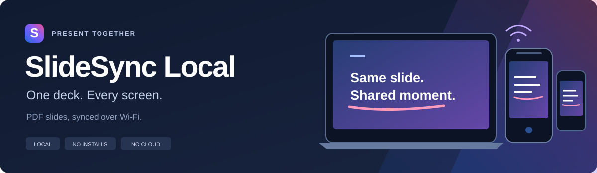
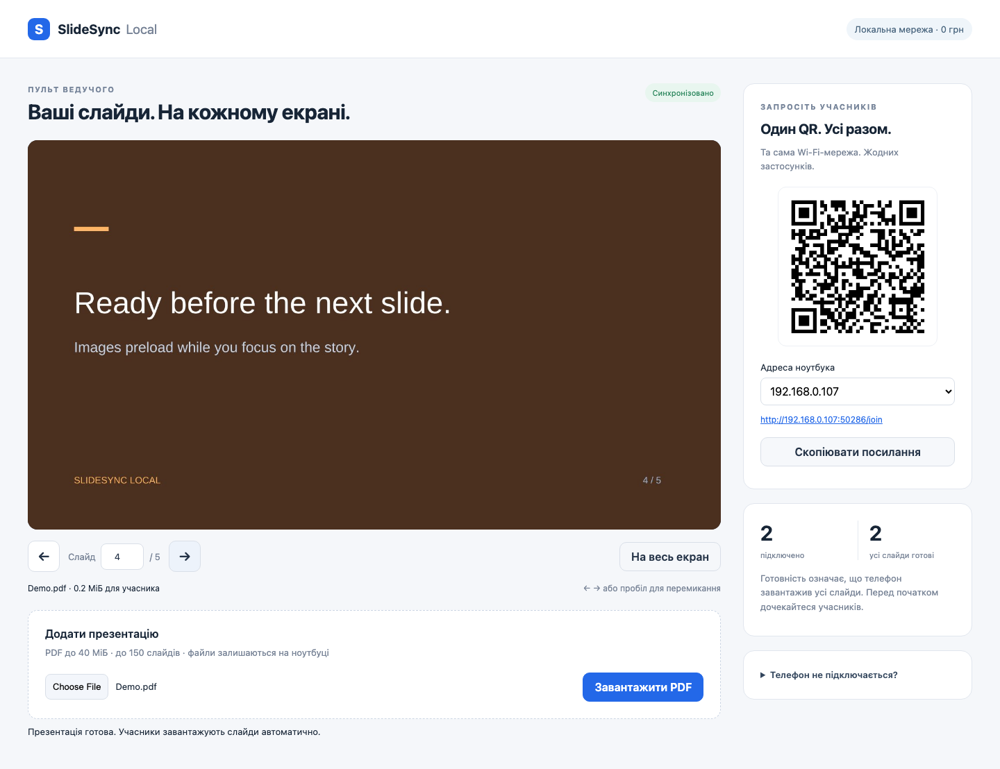
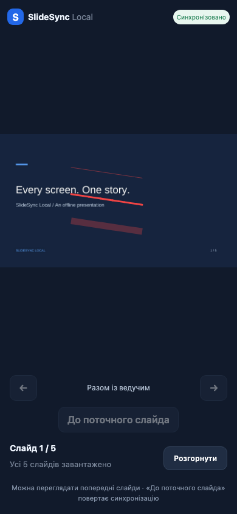

# SlideSync Local

Sync PDF slides to phone browsers over Wi-Fi. No installs. No cloud.

**[Quick start](#quick-start)** · **[Features](#features)** · **[Testing](#testing)** · **[Українська інструкція](docs/README.uk.md)**

## Quick start

Requires **Node.js 22.13+**. Install dependencies once; presentations then work without internet.

```sh
git clone https://github.com/freemlolz/SlideShare.git
cd SlideShare
npm ci
npm start
```

1. Open the full presenter URL printed in your terminal, including `#token=…`.
2. Upload a PDF and connect phones to the same Wi-Fi network.
3. Scan the QR code in Safari or Chrome. Wait for slides to preload, then present.

Keep the laptop awake and the server running. Use `npm run demo` to generate a sample PDF. The app interface is currently in Ukrainian.

## Features

- **Live sync:** WebSocket updates, reconnect, and HTTP fallback.
- **Shared ink:** pencil, pressure-aware brush, and translucent marker; four sizes and any color.
- **Smooth fading:** temporary strokes disappear within five seconds, with a one-second fade; persistent strokes stay until cleared.
- **Clean transitions:** changing slides clears all ink. Manual clear uses a short fade.
- **Personal browsing:** revisit earlier slides on your phone, then return to the presenter's current slide.
- **Local rendering:** PDF pages become JPEGs on the laptop and preload on phones.
- **Connection health:** presenter-only browser profiles, reconnect/disconnect status, HTTP fallback, and preload progress. No device fingerprinting.
- **Quick polls:** save 2- or 4-choice questions, then launch from a floating presenter-only widget, including fullscreen. Vote for 10 seconds; results appear on every screen automatically.

<table>
  <tr><th>Presenter</th><th>Phone</th></tr>
  <tr>
    <td></td>
    <td></td>
  </tr>
</table>

Screenshots use a completed demo session. Join with the QR code in your running app.

## Network & limits

Use a trusted LAN that allows phones to reach the laptop. Guest Wi-Fi client isolation can block connections. HTTP/WS traffic is not encrypted; do not expose this server to the internet.

PDFs: **40 MiB / 150 pages**. Rendered images: **1600 px longest edge / 48 MiB total**. Password-protected PDFs are not supported. Presenter controls require the laptop's loopback address and a separate token.

## Testing

```sh
npm test
npx playwright install chromium webkit
npm run test:browser
```

Chromium and mobile WebKit scenarios cover drawing, fading, history, reconnect, and fallback. Physical iPhone/Android and venue Wi-Fi still need a manual check.

## Documentation

- [Full setup & Safari troubleshooting — Ukrainian](docs/README.uk.md)
- [Architecture](docs/ARCHITECTURE.md) · [Specification](docs/SPECIFICATION.md)
- [Test guide](docs/TESTING.md) · [Validation record](docs/VALIDATION.md)
- [Polls: setup, behavior & limits — Ukrainian](docs/POLLS.md)
