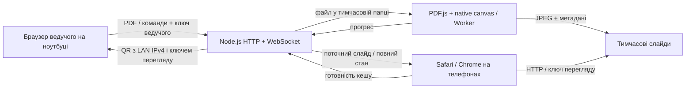

# Архітектура SlideSync Local

## Контекст і рішення

Ноутбук є єдиним сервером, сховищем і джерелом стану. На ньому працює Node.js. Телефони відкривають звичайну HTTP-сторінку з того самого сервера; доступ до інтернету під час показу не потрібен.

Слайди конвертуються на ноутбуці, оскільки рендеринг великого PDF на кожному телефоні збільшує час старту, використання пам’яті та залежність від PDF-переглядача Safari. Компроміс: учасники отримують статичний JPEG з довшою стороною 1600 px; текст не виділяється, масштабування не має векторної якості. Оригінальний PDF не роздається та видаляється з тимчасового сховища після обробки.



## Структура репозиторію

```text
slidesync-local/
  package.json
  package-lock.json
  README.md
  .gitignore
  playwright.config.mjs
  src/
    cli.mjs              запуск, змінні середовища, завершення
    server.mjs           HTTP, авторизація, стан, WebSocket, життєвий цикл
    pdf-worker.mjs       конвертація PDF у JPEG поза основним потоком
  public/
    host.html            пульт ведучого
    host.js              завантаження, команди, QR, лічильники
    viewer.html          сторінка учасника
    viewer.js            перегляд та звіт готовності
    sync.js              HTTP-знімок, WebSocket, reconnect, fallback
    slides.js            кеш JPEG, пріоритети, декодування і захист від перегонів
    style.css            адаптивні стилі обох інтерфейсів
  scripts/
    create-demo.mjs      генерація тестового PDF без зовнішніх ресурсів
  test/
    server.test.mjs      інтеграційні перевірки HTTP, PDF і WebSocket
    browser/
      sync.spec.mjs      наскрізні Chromium/WebKit-перевірки
  docs/
    ARCHITECTURE.md
    SPECIFICATION.md
    TESTING.md
```

Немає бази даних, збирача фронтенду, CDN, телеметрії, сторонніх шрифтів або зовнішніх запитів застосунку. `npm ci` потрібен для встановлення залежностей, а не для кожного запуску.

## Модель стану

Сервер підтримує один стан:

```json
{
  "type": "state",
  "sessionId": "випадковий ідентифікатор запуску",
  "revision": 12,
  "slide": 0,
  "deck": {
    "id": "випадковий ідентифікатор презентації",
    "name": "presentation.pdf",
    "pages": [{ "width": 1600, "height": 900, "bytes": 42100 }],
    "totalBytes": 42100
  },
  "processing": null,
  "participants": 3,
  "ready": 2
}
```

`slide` — індекс від нуля; інтерфейс показує номери від одиниці. За відсутності презентації `deck` дорівнює `null`. Під час конвертації `processing` містить `{done,total}`, де `total` спочатку може бути `null`.

Кожна зміна, включно з прогресом і кількістю учасників, збільшує `revision`. Heartbeat передає той самий стан без збільшення версії. Клієнт відкидає старіші версії, щоб запізніла HTTP-відповідь не відкотила отриманий через WebSocket слайд. `sessionId` відокремлює новий запуск сервера від попереднього.

## Життєвий цикл PDF

1. Запит ведучого перевіряє loopback-адресу, ключ, Host та Origin до приймання файла.
2. Глобальний прапорець зайнятості дозволяє лише одне завантаження/перетворення. Паралельний запит отримує `409`.
3. Multer записує один файл у випадковий шлях у системній тимчасовій папці. Ліміт — 40 МіБ. Початок файла має бути `%PDF-`.
4. Worker читає PDF.js із локальними CMap, стандартними шрифтами та WASM. У PDF.js вимкнено eval. PDF із паролем відхиляється.
5. Після перевірки кількості сторінок Worker послідовно рендерить кожну сторінку. Біла підкладка, правильний поворот PDF, збереження пропорцій, довша сторона 1600 px, JPEG quality 85.
6. Основний потік приймає прогрес і продовжує обслуговувати поточний показ. Максимум 150 сторінок, 48 МіБ готових JPEG, 120 секунд на роботу Worker.
7. Лише після успішного завершення Worker нові метадані стають активними однією зміною стану. Поточний слайд скидається на перший, готовність учасників скидається.
8. При помилці нові часткові файли видаляються; активний показ зберігається. При успіху видаляються попередні JPEG і завантажений оригінал.

Тимчасова папка має вигляд `slidesync-<random>/uploads/...` і `<deckId>/slides/1.jpg`. Користувацьке ім’я PDF зберігається лише як текстова назва, не використовується як шлях. `Ctrl+C` / `SIGTERM` зупиняють Worker, з’єднання та прибирають папку. Раптове вимкнення не гарантує прибирання.

## Транспорт і відновлення

Клієнт спочатку очікує завершення HTTP-знімка стану, тоді відкриває WebSocket. Це зменшує ризик відомих проблем Safari на старті. Завантаження зображень може тривати паралельно з WebSocket; тому передбачено reconnect і незалежний HTTP fallback.

При встановленні WebSocket сервер одразу надсилає повний стан. Після команди ведучого він транслює новий повний стан усім відкритим сокетам. Бінарні зображення не передаються через WebSocket.

- Сервер раз на 10 секунд надсилає ping та знімок стану. Клієнт без pong до наступної перевірки від’єднується.
- Повторне підключення: 0,5 секунди, подвоєння до 10 секунд плюс випадкові 0–250 мс.
- Watchdog раз на 3 секунди запускає HTTP-знімок, якщо WebSocket не відкритий або повідомлень немає понад 15 секунд.
- Завислий відкритий сокет без повідомлень понад 22 секунди закривається. Спроба відкриття обмежена 7 секундами.
- HTTP-знімок має timeout 6 секунд. Події `visibilitychange`, `pageshow`, `online` запускають оновлення після повернення до активної вкладки.
- У фоні активне перепідключення та опитування не запускаються; ОС все одно може заморозити сторінку. Після повернення береться актуальний стан.
- Сокет із понад 1 МіБ невідправлених даних закривається; після reconnect клієнт отримає актуальний знімок.

HTTP fallback забезпечує перегляд, але не реєструє учасника та готовність: ці метрики визначаються живими WebSocket-з’єднаннями. Показник рахує вкладки, а не унікальні фізичні телефони.

## Попереднє завантаження

Поточний JPEG завантажується негайно. Через коротку затримку стартує фонова черга: поточний, наступний, попередній, решта слайдів. Фонових запитів не більше двох; поточний кадр може додати один окремий запит. Запити одного слайда об’єднуються.

Кожний JPEG зберігається як Blob URL. Це утримує стиснуті дані без збереження 150 декодованих зображень. Після завантаження потрібний кадр декодується через `Image.decode()` і замінює попередній. Лічильник запитів і покоління презентації відкидають запізнілі відповіді: швидкі команди не мають показати старий кадр після нового.

Загальний ліміт стиснутих JPEG — 48 МіБ. Це не ліміт усієї пам’яті вкладки: браузер використовує додаткову пам’ять для декодування й внутрішнього кешу. При новій презентації всі Blob URL відкликаються, старі запити скасовуються. Невдалі фонові запити повторюються. Повне завантаження означає готовність compressed assets; сервер не перевіряє їх криптографічно та довіряє звіту клієнта.

## Межі довіри

- Ключ ведучого та ключ перегляду — різні випадкові 192-бітні значення; порівняння має сталий час для однакової довжини.
- Ключ ведучого видається лише в терміналі. Навіть правильний ключ не дозволяє керувати з мережевого інтерфейсу: потрібен loopback.
- QR містить лише ключ перегляду у fragment. Сторінка зберігає його у `sessionStorage` і прибирає fragment із видимої адреси. Для HTTP-запитів зображень/стану та WebSocket ключ додається в query; сервер не має access log.
- Перевірка Host допускає лише localhost та адреси мережевих інтерфейсів, зафіксовані при старті. Origin, якщо присутній, має відповідати HTTP-джерелу запиту. Відсутній Origin дозволено для CLI-клієнтів, але автентифікація залишається обов’язковою.
- Дозволено лише серверні команди ведучого через HTTP. WebSocket-повідомлення учасника змінюють лише звіт готовності.
- CSP блокує сторонні скрипти та вбудовування сторінки. Для локального WS дозволено `connect-src ws:`; кінцева адреса формується з поточного `location.host`.
- Немає TLS, багатокористувацьких облікових записів, rate limiting проти ворожої LAN або ізоляції нативного PDF-декодера. Це межі MVP для довіреної локальної мережі.

## Залежності й компроміси

Express відповідає за HTTP; `ws` — за WebSocket, `multer` — за обмежений multipart, `qrcode` — за локальний PNG. PDF.js та `@napi-rs/canvas` забезпечують серверний рендеринг без встановлення системного Poppler. Playwright потрібен лише для тестування. Усі версії зафіксовані в `package.json` і `package-lock.json`.

Простий браузерний JavaScript зменшує кількість інструментів і дає запуск без build-кроку. Один процес і один Worker достатні для однієї презентації; горизонтальне масштабування, віддалений пульт і декілька кімнат не входять до поточного життєвого циклу.
